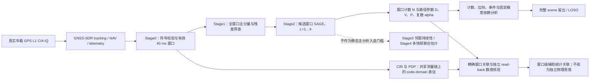
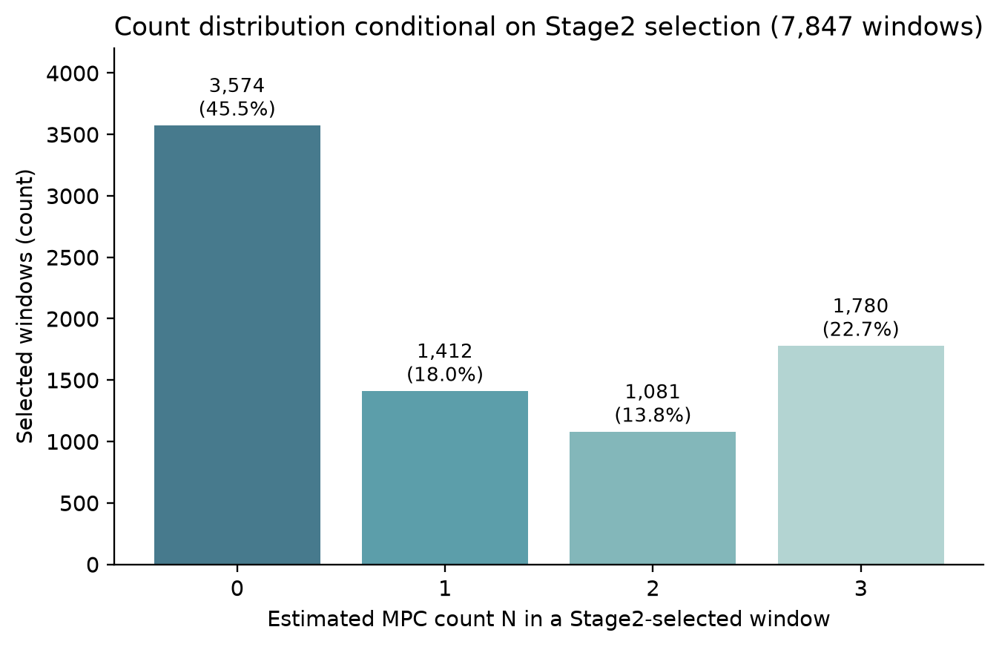
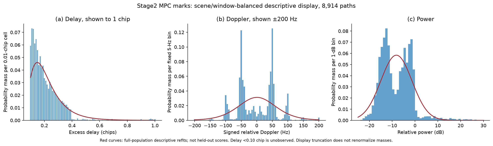
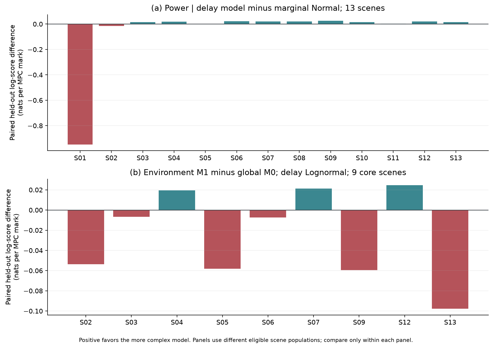
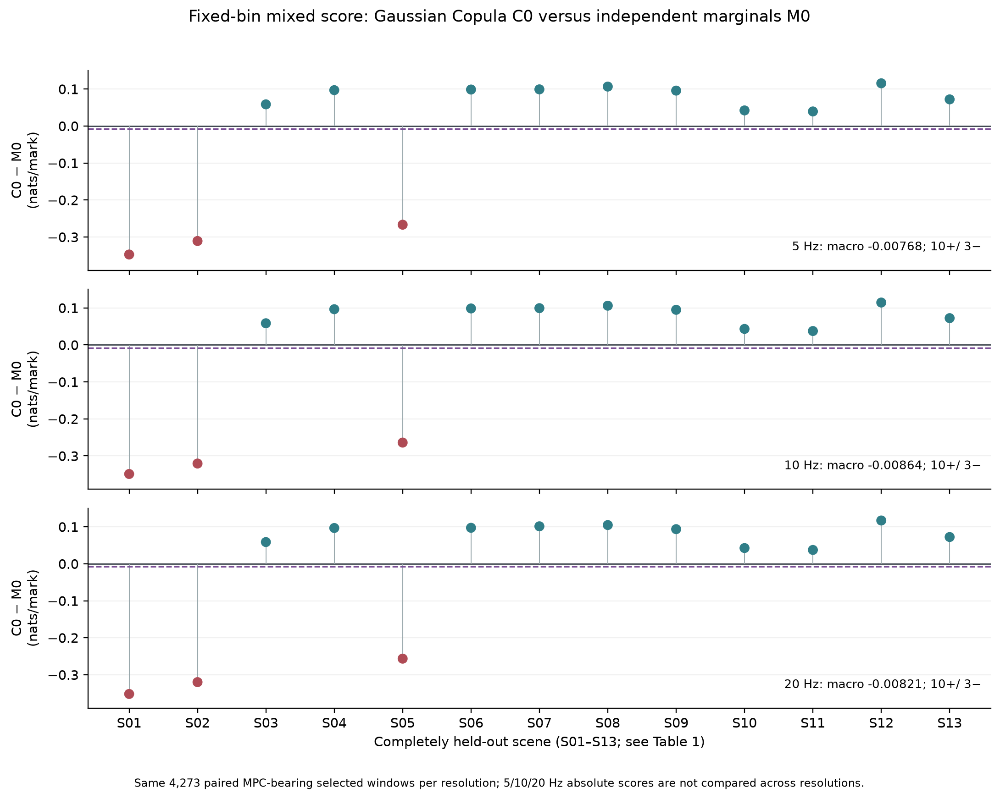

# GNSS 实测多径参数提取与静态统计建模——第一阶段总结报告

**版本：** 2026-10-31
**研究范围：** Mainline Stage2；真实车载 GPS L1 C/A 录制中的 NAV 辅助 SAGE 估计输出及其静态统计表征
**总体状态：** WP1–WP6 均为 `COMPLETED_WITH_LIMITATIONS`；WP4 Gate E/F 为 `PASS_WITH_LIMITATIONS`；WP6 Gate G 为 `PENDING`；Phase-2 生成式 AI 路线为 `PLANNED_ONLY`。

> 本报告总结已完成的研究，不是期刊论文或新的模型验收。数值以最新 WP4–WP6/Gate G 独立审阅和冻结结果为准；早期 V0 中“Gate E/F 待验收”等状态已被后续审阅更新。本报告没有重跑 SAGE、CIR、alpha 或统计拟合。

## 第一章　研究背景与第一阶段目标

GPS L1 C/A 信号在道路环境传播时可能经建筑、地面和其他物体反射后，与直达或主导分量同时到达接收机。多径会改变码相关函数、载波相位和跟踪环路观测，进而影响定位与信号质量。要把多径研究从“某个场景看起来有几个相关峰”推进到可复现的统计分析，需要回答两个彼此不同的问题：一是估计器在给定数据和处理条件下输出了怎样的路径参数；二是用这些输出建立的统计规律能否迁移到没有参与拟合的录制场景。

本阶段回答的是后一问题中的**估计器输出统计**：在冻结的 NAV 辅助 SAGE 流程和 Stage2 选择条件下，已选 40 ms 窗口中的估计 MPC 数量、超额时延、相对 Doppler 和相对功率具有哪些可重复描述；复杂的环境、仰角、参数依赖模型是否比简洁基线更能预测完整留出场景。估计路径不等同于经独立真值确认的物理反射体；所有主要推断因此限定于这一 SAGE/Stage2 观测总体。

**图 1　第一阶段处理与证据边界。** SAGE 参数统计以 Stage2 输出为主体；CIR/PDP 和 alpha 用于可追溯关联与内部数值核对。Stage3/Stage4 是后续稳定性标签，不用来筛选本报告的 8,914 条 MPC。

## 第二章　原始数据、参数提取与数据集形成

### 2.1 测量总体与场景支持

数据来自真实车载 GPS L1 C/A 录制，并使用 GNSS-SDR 的 tracking、导航符号和相关元数据支持窗口构造及 SAGE 搜索。13 个 scene、83 个 run 构成冻结总体；run 是与场景、PRN/跟踪通道处理身份对应的计算单元，不是 83 次独立环境实验。13 个场景的元数据采样率均为 10.23 MHz，配置码率为 1.023 MHz，因此每 chip 为 10 samples。现有可核实材料没有足够依据统一报告接收机/天线型号、精确采集地点或所有 run 的独立物理路线；本报告不补写这些信息。

| 显示编号 | 冻结 scene ID | 环境标签 | run 数 | Stage0 有效窗口 | Stage2 已选窗口 | Stage2 MPC |
|---|---|---|---:|---:|---:|---:|
| S01 | `F1023_V120_D0121_P2` | Highway/Open | 13 | 177,588 | 841 | 104 |
| S02 | `F1023_V70_D0117_P2` | Mountain/Valley | 7 | 7,092 | 592 | 837 |
| S03 | `F1023_V70_D0117_P4` | Mountain/Valley | 7 | 6,250 | 761 | 1,093 |
| S04 | `F1023_V70_D0120_P1` | Urban | 3 | 6,327 | 330 | 334 |
| S05 | `F1023_V70_D0120_P5` | Urban | 5 | 4,242 | 483 | 671 |
| S06 | `F1023_V70_D0120_P7` | Urban | 4 | 8,916 | 439 | 707 |
| S07 | `F1023_V70_D0120_P8` | Urban | 4 | 3,540 | 447 | 442 |
| S08 | `F1023_V70_D0120_P9` | Special Reflective | 9 | 19,909 | 987 | 1,172 |
| S09 | `F1023_V70_D0122_P1` | Urban | 8 | 12,281 | 842 | 1,429 |
| S10 | `F1023_V70_D0122_P2` | Special Reflective | 7 | 18,167 | 669 | 832 |
| S11 | `F1023_V80_D0117_P8` | Highway/Open | 5 | 5,214 | 449 | 471 |
| S12 | `F1023_v50_D0127_P1` | Urban | 5 | 9,090 | 386 | 115 |
| S13 | `F1023_v90_D0117_P7` | Mountain/Valley | 6 | 7,136 | 621 | 707 |
| **合计** | **13 scenes** | Urban 6；Mountain/Valley 3；其余各 2 | **83** | **285,752** | **7,847** | **8,914** |

场景表和机器可读来源：[`T1_scene_population.csv`](mainline_stage2_v0/figures_final/T1_scene_population.csv)、V0 冻结报告 [`v0_model_report.md`](../../reports/data_consolidation_20261003/mainline_1023_model_v1/v0_20261024T132210Z/v0_model_report.md)。

### 2.2 Stage0 到 Stage4 的处理逻辑

**Stage0：有效符号与 40 ms 窗口。** 冻结实现读取目标 GPS PRN 的导航符号、tracking 结果与轨迹元数据；符号必须为 ±1，telemetry 与最近 tracking sample 的偏差不超过 2 samples，PRN 一致，载噪比 C/N₀ ≥ 30 dB-Hz，carrier-lock 测试值若有限则须不低于 −0.5。相邻 20 ms 符号要求样本步长与 TOW 连续性分别满足 2-sample、2 μs 容差；只有原 telemetry 行也连续时才形成两个相邻符号组成的 40 ms 窗口。车辆速度可用于确定 Doppler 搜索界限；速度缺失时使用 120 km/h fallback。上述条件是实现定义，不表示它们是对所有接收机/道路场景的普适最优质量门槛。

**Stage1：全量快速筛查。** 对 285,752 个 Stage0 窗口执行 NAV 符号擦除后的扫描。主分量粗搜索覆盖 delay −5 至 +10 samples、25 Hz Doppler 步进及 ±125 Hz 主 Doppler 区间，再用局部搜索细化。对主分量扣除后的残差，在最小 1-sample 与最大 30-sample 超额时延范围内搜索残余峰；筛查使用 −25 dB 残差功率门槛、2-sample delay 和 40 Hz Doppler 峰间隔。基础候选优先按双强残差峰排序，再按首残差峰排序；每 run 最多保留 24 个基础候选，候选不足时最低补到 8 个，并对基础候选索引两侧各扩展 2 个相邻窗口。邻域扩展后 Stage2 窗口总数不受“24 个基础候选”上限直接约束。

**Stage2：候选窗口的分数时延 SAGE。** 每个候选比较总路径阶数 L∈{1,2,3,4}，令额外 MPC 数 N=L−1。新增路径由残差信号初始化，随后 SAGE 逐路径更新局部 delay/Doppler 并以复数最小二乘更新复系数；最多 10 次迭代，RSS 相对变化低于 10⁻⁶ 时停止。实现采用 0.1-sample delay 网格（0.01 chip）、最小路径间隔 1 sample（0.10 chip）、局部 Doppler 名义 5 Hz 步长/±30 Hz 半宽。增加阶数要求顺序 BIC 改善至少 10、代码记录的 RSS 百分比改善至少 0.002，并通过有限值、最小 MPC 相对功率 −25 dB、速度相关 Doppler bound 与最大副本相干度 0.98 等有效性条件。代码按 `100 × (RSS_(L−1)−RSS_L)/RSS_(L−1)` 计算 RSS 百分数，再与 0.002 比较；这是冻结实现配置，不应误读成已经通过科学优化证明的通用阈值。

实现的模型评分写作

\[
\mathrm{BIC}_L=2n\log(RSS_L/n)+k_L\log(2n),\qquad k_L=4L+1,
\]

并以逐阶 BIC 增益和 RSS 条件决定是否继续增加路径。路径最终按 delay 排序；`path_id` 因而是估计器中的延迟秩，而非跟踪到的物理反射体 ID。全量 Stage2 参数表保留直达参考路径与所有 MPC。

**Stage3/Stage4：辅助稳定性标签。** Stage3 检查中心路径在相邻 40 ms 窗口中的持续性，配置为 ±2 个窗口邻域、至少 3 个连续匹配，并比较 delay、Doppler、power 容差。Stage4 对 Stage3 可靠中心实施五快照、约 100 ms 的共同几何联合估计。两阶段提供时间稳定性/多快照证据，但静态建模总体仍按 Stage2 选中窗口定义；Stage3/Stage4 结果不把估计路径提升为已验证的物理反射体。

### 2.3 分母与建模输入

| 数据层 | 数量 | 单位/分母 | 可回答的问题 | 不能作出的解释 |
|---|---:|---|---|---|
| Stage0 有效窗口 | 285,752 | NAV/tracking 支持的 40 ms 窗口 | Stage1/2 的候选母体规模 | 未入选窗口无 Stage2 同口径 (N) 标签 |
| Stage2 已选窗口 | 7,847 | 唯一 `(run_id, window_id)` | 条件于 Stage2 选择的窗口计数 | 不是全部观测的无条件多径发生率 |
| Stage2 已选、`N=0` | 3,574 | 已选窗口 | 估计器未保留额外 MPC 的已选窗口 | 不等于物理无多径 |
| MPC-bearing 已选窗口 | 4,273 | `N>0` 的已选窗口 | 路径参数和标记评分支持 | 多个窗口/路径不能视为独立重复 |
| Stage2 MPC | 8,914 | `(run_id, window_id, path_id)` | delay、Doppler、relative power 等路径级估计量 | 不等于 8,914 条已确认物理反射路径 |
| Direct-reference 路径 | 7,847 | 每个选中窗口一条 | 窗口内相对量参考 | 不保证是真实 LOS 或最强路径 |
| Stage2 全路径 | 16,761 | direct-reference + MPC | 路径账本及 alpha 对照 | 与 MPC 计数不同，不能将两者混称 |
| 全部 Stage0 CIR 快照 | 11,430,080 | 285,752 窗口 × 40 个 1 ms 快照；每快照 451 bins | code-domain CIR/PDP 表示 | 不构成独立传播真值 |

7,847 / 285,752 = **2.7461% Stage2 选择覆盖率**，仅表示进入 Stage2 的比例。Stage1 未选中的 277,905 个 Stage0 窗口不能补作 `N=0`。窗口计数使用 7,847 个已选窗口，包括 3,574 个 `N=0`；路径边际和固定分箱比较使用 8,914 条 MPC，评分时按窗口与 scene 组织，不能把 MPC 行数当成独立样本量。

### 2.4 来源追溯与版本边界

主结果由冻结 V0、WP2、WP3、WP4、WP5、WP6 与 Gate G 补充包构成；路径和窗口键分别采用 `(run_id, window_id, path_id)` 与 `(run_id, window_id)`。WP5/Gate G 的历史来源清单记录冻结 SAGE runner SHA-256 `bffc123c97af77f0a797f417d3866e9a34feab7729c5c1575352f53bc3571b9c`。本报告核对时，当前科研工作树中的 `scripts/sage_pipeline/run_nav_sage_pipeline.m` SHA-256 为 `9a263f8b45c2402b4232f242893cf407f55f0c362e5cbb7369c3bf310b8589f8`，与历史冻结 hash 不同。因此当前源码用于解释实现结构，但本报告**不声称其字节与历史运行文件相同**；执行身份以历史 manifest、每 run 冻结 hash 与相应结果包为准。WP5 另有 5 个历史 MAT 文件没有逐文件历史 receipt SHA，WP5 报告明确将之后建立的 manifest 作为本次处理一致性记录，而非历史时点的 SHA 证明。

## 第三章　建模变量与参数定义

令窗口 `i` 中按 delay 排序的 SAGE 路径为 `ell=0,...,L_i−1`，`ell=0` 表示 direct-reference estimate，`ell>0` 为 MPC。hat 表示算法估计值。

### 3.1 MPC 数量 (N_i)

\[
N_i=L_i-1\in\{0,1,2,3\}.
\]

统计单位是 Stage2 已选中的 40 ms 窗口。`N=0` 表示该账本中未保留额外 SAGE 路径。该变量由候选窗口筛选、模型阶数搜索、可分辨率和阈值共同决定，不能解释为“真实多径个数”的无误差真值。

### 3.2 超额时延 (D_{i\ell})

\[
D_{i\ell}=\frac{\hat\tau_{i\ell}-\hat\tau_{i0}}{10}\quad\text{chips},\qquad \ell>0.
\]

(hat\tau) 的原始单位是 samples；10 samples/chip，1 chip 约为 977.517 ns。以主码率换算，时延差可转换为等效路径长度差，但这依赖相关/码延迟解释，不直接识别反射体几何路径。搜索步长 0.01 chip、路径最小分离 0.10 chip、Stage2 选择及尾部支持都会塑造所见分布；观测最小值 0.10 chip 不表示物理延迟小于该值不存在。

### 3.3 带符号相对 Doppler (V_{i\ell})

\[
V_{i\ell}=\hat\nu_{i\ell}-\hat\nu_{i0}\quad\text{Hz}.
\]

它是 MPC 相对当前 direct-reference estimate 的频移差，保留正负号；可与运动和传播几何共同有关，但不是车辆速度，也不是单独某个散射体的径向速度。搜索范围按跟踪/NMEA 速度或 fallback 确定，局部格点依窗口、路径与迭代中心自适应。冻结输出没有保存逐路径逐轮候选格点与胜出轨迹，故不能把最终连续数值当成精确已知的 5 Hz 量化单元。

### 3.4 相对功率 (P_{i\ell})

\[
P_{i\ell}=10\log_{10}\left(\frac{|\hat\alpha_{i\ell}|^2}{|\hat\alpha_{i0}|^2}\right)\quad\text{dB}.
\]

功率来自 SAGE 窗口归一化观测上的复系数幅度平方比，因而是同窗相对量，不是经接收机前端/天线校准的绝对 RF 功率。相对值可能为正；参考路径不保证物理 LOS 或最强分量。

### 3.5 环境、仰角、CIR/PDP 与复数 alpha

- **环境标签：** 13 个 scene 被标记为 Urban (6)、Mountain/Valley (3)、Highway/Open (2)、Special Reflective (2)。标签以 scene 为单位，不是逐路径的随机环境样本。
- **卫星仰角：** 全 7,847 个选中窗口的来源计数为 GSV 实测 5,128、星历推导 1,665、缺失 1,054。推导仰角中 622 条使用可关联 GGA 椭球高，1,043 条使用零高度假设；后者不是实测高度。WP3 核心 9 场景中，GSV 实测 3,478 个窗口、推导/GGA 206、推导/零高 701、缺失 516，M2 来源分层拟合，没有把来源混并或把缺失补零。
- **复数 alpha：** 冻结 SAGE 对去均值、RMS 归一化并 NAV-wiped 的单个 40 ms IQ 窗口，构造局部延迟/Doppler 副本矩阵 (A)，估计 \(\hat\alpha=\arg\min_\alpha\|y-A\alpha\|_2^2\)。导出保存实部、虚部、幅度 (|\alpha|) 与主值相位 `angle(alpha)`（弧度）。全量身份和数值复核证明导出/属性一致，不证明跨窗口相位参考连续，也不提供绝对增益。
- **CIR/PDP：** 每个 Stage0 窗口存有 40 个 1 ms 复 CIR 快照、451 个 delay bins，延迟轴为 −5:0.1:40 samples。PDP 为

  \[
  \mathrm{PDP}_{ik}=\frac1{40}\sum_{m=1}^{40}|\mathrm{CIR}_{imk}|^2.
  \]

  其中 `k` 是 code-delay bin。PDP 是窗口内非相干功率平均；加权 code-delay 宽度是相关响应的宽度，未被验证为物理多径 RMS delay spread。CIR/PDP 与 SAGE 共用录制/Stage0 tracking 支持，不是独立外部信道真值。

## 第四章　静态统计模型与评价方法

### 4.1 选中窗口内计数

目标是 `p(N=n | S=1)`，其中 `S=1` 表示 Stage2 已选。场景 `s` 的 `W_s` 个选中窗口中，`W_(s,n)` 个属于 `N=n`。经验候选在训练 scenes 上对各场景计数比例等权平均；比较对象为截断到 0–3 支持的 Poisson 与 NB2。计数分数以每个留出 scene 的全部已选窗口平均 log probability 计算，再对 scene 等权宏平均。NB2 若均值趋于无穷边界，按边界解记录，而不称为有限内部 MLE。

### 4.2 路径参数边际分布

正值 excess delay 比较 Lognormal（固定 location=0）、Gamma 与 Weibull；有符号 Doppler 与 dB 相对功率比较 Normal、Student-t 与 Laplace。候选比较只在同一变量、相同支持、相同训练/测试身份和同一概率测度下解释。路径在同窗、同场景内相关；WP3/WP6 用 scene/window 权重或复合/伪似然平衡贡献，不把路径伪装成独立物理散射体。全量拟合参数用于描述，不作为这些数据自身的场景外预测。

### 4.3 完整场景留出与稳健性

完整 scene 是外层泛化单位。每一折将该 scene 的所有 run、PRN/channel、重叠窗口与路径整体留出；训练折仅从其余 scenes 拟合或选择。WP3/WP6 的必要模型选择使用训练折内场景留出。折间训练集高度重叠，13 个 LOSO 分数不是 13 次独立实验。报告使用 per-scene 分数、同身份配对 delta 与 scene macro；不基于 8,914 行计算路径级 iid 标准误或显著性。

### 4.4 条件模型与功率—时延关系

WP3 定义 M0 为核心 9 个 Urban/Mountain scenes 的全局参数，M1 为 Urban 与 Mountain/Valley 分环境参数；M2 在来源纯净子集内增加连续仰角。正值分布可令 \(\log(scale)=\alpha_e+\beta(E-45^\circ)/10\)，有符号分布可令 \(location=\alpha_e+\beta(E-45^\circ)/10\)。GSV、GGA 派生、零高假设分开评估。模型差只在同一测试身份配对。

功率—时延分析比较 pooled 相关/OLS 描述与完整 scene 留出条件线性预测，对照只用边际功率的基线。相关系数反映样本内单调关联，不等同于条件预测增益或因果效应。

### 4.5 固定箱宽依赖评分及其目标

时延观测按 0.01 chip 单元处理；固定 Doppler 目标以 0 Hz 为箱中心，箱宽 (w=5) Hz 为主，10/20 Hz 为预定敏感性分析，区间边界为 \([(k-\tfrac12)w,(k+\tfrac12)w)\)。功率仍以连续密度评分。独立边际对一个 mark 的评分项为

\[
q_I(A_D,A_V,p)=P_D(A_D)P_V(A_V)f_P(p).
\]

Gaussian Copula 候选使用训练场景估计相关矩阵 (R)，对 delay 与 Doppler 两个离散潜变量区间联合积分，并条件于连续功率的 latent PIT：

\[
q_C(A_D,A_V,p)=f_P(p)\int_{z_D^-}^{z_D^+}\int_{z_V^-}^{z_V^+}
\frac{\phi_3(z_D,z_V,z_P;R)}{\phi(z_P)}\,dz_V\,dz_D,
\quad z_P=\Phi^{-1}(F_P(p)).
\]

外层固定 13-scene LOSO；边际选择与 Copula 参数都仅由训练 scenes 决定。每个箱宽内独立边际与 Copula 在相同留出窗口、路径及 scene 上配对。该评分的目标是**固定分箱后的 Stage2 估计输出**，不是冻结 SAGE 自适应搜索器的精确输出似然；不得横向比较不同箱宽的绝对得分。

## 第五章　各建模维度的实际结果与效果

### 5.1 Stage2 窗口 MPC 数量

| (N) | 窗口数 | 占 7,847 个 Stage2 已选窗口 |
|---:|---:|---:|
| 0 | 3,574 | 45.546% |
| 1 | 1,412 | 17.994% |
| 2 | 1,081 | 13.776% |
| 3 | 1,780 | 22.684% |
| **合计** | **7,847** | **100%** |

13-scene LOSO 中，经验分类计数宏平均为 −1.297385 nats/selected window；截断 Poisson 相对经验基线差 −0.171584，截断 NB2 差 −0.018255 nats/window。NB2 在 13/13 折落到均值趋于无穷的边界。数据支持以经验分类分布作为当前 Stage2 选中窗口总体的简洁计数基线；不支持把它解释为全 Stage0 的多径发生率或建立无条件观测计数模型。

**图 2（复用 F2）。** 分母为 7,847 个 Stage2 已选窗口；`N=0` 是已选窗口内估计器未保留额外 MPC，不是未入选 Stage0 窗口或真实无多径标签。

### 5.2 超额时延

在 V0 的 13-scene LOSO 候选比较中，Lognormal 宏平均 log density 为 0.887860 nats/mark，高于 Gamma 的 0.712347 与 Weibull 的 0.542103；Lognormal 在 13/13 个折排名第一。WP2 重用 V0 已保存的折参数做逐场景敏感性汇总，并未把这些结果冒称为第二次独立拟合。WP3 核心 9 场景 M0 的 Lognormal 在 9/9 折排名首位。最新固定箱宽 nested 评价中，训练折内选择的 delay 族为 Lognormal 13/13；这几次分析来自同一冻结总体，属于一致性证据，不是独立复现队列。

WP6 全总体、场景/窗口平衡描述性重拟合为 Lognormal shape \(\sigma=0.510756\)、scale \(e^\mu=0.192930\) chip、location 固定为 0。WP3 的九场景 M0 全数据描述参数为 shape 0.465969、scale 0.191493 chip、location 0；因目标总体和权重不同，两组数字不可混作同一估计量。较稳定的结论是“Lognormal 是当前选中、量化且受最小间隔约束的 delay 输出的有效候选”，不是自然界延迟分布的普适定律。

**图 3（复用 F3）。** 8,914 条估计 MPC；曲线是全总体描述性拟合，不是留出预测。0.01 chip 网格、0.10 chip 最小间隔及尾部低支持均须与图同时说明。

### 5.3 相对 Doppler 与相对功率

**Doppler。** V0 13-scene 宏平均 log density 中 Student-t 为 −5.719571、Normal 为 −5.729153、Laplace 为 −5.826876 nats/mark；Student-t 与 Normal 接近。WP2 rank-1 次数是 Normal 6/13、Student-t 5/13、Laplace 2/13，未出现压倒性赢家。固定箱宽、训练折嵌套选择后的结果随分辨率变化：Student-t 在 5 Hz 为 11/13、10/20 Hz 为 13/13。由于冻结 SAGE 的 Doppler 搜索格点会按 tracking reference、速度界限、逐路径局部中心裁剪，`makeGrid` 还可能追加非等距端点；2,861 个多 MPC 窗口中 2,753 个满足窗口平移 5 Hz 格点筛查，108 个不满足。逐轮搜索轨迹未保存，所以旧连续 Doppler 密度综合评分只作近似诊断；固定箱宽评分是明确粗粒化目标，不能解释为原 SAGE 自适应算法的精确似然。

**相对功率。** V0 宏平均 log density 中 Normal −3.319460，Student-t −3.321117，Laplace −3.350018 nats/mark；Normal 与 Student-t 几乎相同。WP2 的折排名 Student-t 8/13、Normal 3/13、Laplace 2/13；最新固定箱宽训练折选择中 Student-t 8/13、Normal 5/13。全数据训练指标偏好与场景外排名并不一致，故保留 Normal/Student-t 竞争候选，不将任一个说成稳定唯一模型。

WP6 全总体、场景/窗口平衡描述性拟合参数为 signed-Doppler Student-t \(\nu=8.172952,\ location=0.759586\) Hz、scale 61.776353 Hz；relative-power Normal \(\mu=-8.157576\) dB、\(\sigma=6.826866\) dB。这些是全数据描述值，不是留出预测参数；带 Doppler 连续密度的旧联合评分不能作为正式模型排名。

### 5.4 功率—时延统计关联

V0 pooled 8,914 条 MPC 的 Spearman \(\rho=-0.616410\)，OLS 斜率 −8.209394 dB/chip、\(R^2=0.055343\)。按完整 scene 重采样的探索性 95% 区间为斜率 [−14.288980, −3.852434] dB/chip、rho [−0.680960, −0.540977]；它以 scene 为块，但只有 13 个 scene，不是无限总体保证。WP2 的 13 个留出拟合斜率全部为负，中位数 −2.50632 dB/chip，范围 [−10.5248, −2.25958]。

决定是否把关系用于预测时，conditional-minus-marginal scene-macro log-score 为 −0.0605013 nats/mark，whole-scene bootstrap 95% interval [−0.210037, +0.0174261]；RMSE 差为 +0.182619 dB，正值表示条件模型误差更大。因此负相关作为 Stage2 条件总体的描述性关联可以报告；线性条件项没有带来可靠场景外提升，也不构成 delay 导致功率衰减的因果证据。

### 5.5 环境、仰角及运动条件

WP3 的核心比较限于 Urban 6 scene 与 Mountain/Valley 3 scene；M1 的三个参数候选族配对宏差均未显示稳定优势。以 excess-delay Lognormal 为例，M1−M0 在同一 9-scene 配对测试总体的差为 −0.024218 nats/mark。Mountain/Valley 只有 3 个 scene，不能支撑强的环境总体推断；Highway/Open 和 Special Reflective 各 2 个 scene，仅作描述/适用性分析。

仰角 M2 按几何来源分层，连续项作用于正值分布 log(scale) 或有符号分布 location。GSV 实测子集中，delay 的 M2−M0 候选分数约在 −0.8860 至 −0.0448，Doppler 在 −0.1131 至 −0.0082 nats/mark；relative-power 的 M2−M0 从 −0.1247 到 +0.0120，存在混合结果。relative-power 的 M2 相比 M1 可有正差，但不能据此覆盖 M2 相比 M0 的不一致证据。M2 未被提升为普适仰角条件模型。

WP3 核心 9 场景共有 3,478 个 GSV 实测窗口、206 个星历/GGA 高度推算、701 个星历/零高假设和 516 个仰角缺失窗口。缺失没有插补；零高样本明确是几何假设。运动数据仅描述：核心场景中 3,372 个已选窗口有速度值，但来源只有 144 条不同 NMEA 记录，单记录最多复用 96 个窗口，且存在高速度质量疑问；没有正式拟合运动条件 M3。

**图 4（复用 F4）。** 上面板是 WP2 的 13-scene power-delay 对照；下面板是 WP3 的 9-scene Urban/Mountain 对照。分母、训练总体不同，不得把两面板直接横向比较。负差表示复杂候选分数低于基线。

### 5.6 留出尾部与拟合失败

WP2 使用训练折参数检查 p01/p05/p10/p90/p95/p99 留出分位数，1,026 条 family/scene/quantile 诊断中 324 条因名义目标尾部记录少于预设 10 被标为低支持；这些记录保留，不把总体直方图或训练拟合称为尾部校准通过。WP3 另有 2,268 条 p05/p50/p95 诊断，其中 279 条拟合不可用、579 条名义尾部行数低于 10。WP6 final 嵌套诊断另保留 72/234 条低支持尾部记录和 6 条优化失败。它们来自不同分析口径/网格，不应相加；名义 MPC 行数也不是有效独立样本量。

### 5.7 计数条件标记与路径秩

Gate G 补充对 `N=1,2,3` 的条件标记进行完整 scene 留出诊断。`N=1` 的 delay 族在 13 个外层折均因边界拟合无法选择，故任何以完整条件支持为前提的总模型比较不能覆盖 1,412 条 `N=1` MPC。排除它们后的 paired M1−M0 平均 scene delta 为 +0.119126 nats/MPC（12 正、1 负）；`N=2` 为 −0.005815、近于零；`N=3` 为 +0.202086，但有 scene 中最少仅 3 个窗口，属支持薄弱的描述性结果。路径 `path_id` 是按时延排序的估计器秩；相邻秩在 `N=2/3` 中以 0.10 chip 最小间隔分开，后续 rank 相对功率总体更低。该结构反对未经检验的窗口内可交换/条件 iid 假设，但不是物理散射体排序或身份跟踪证据。

### 5.8 固定分箱 Gaussian Copula 对照

在声明清楚的固定观测目标上，独立边际与 Copula 对每种箱宽均使用相同的 4,273 个 MPC-bearing 已选窗口、8,914 条 MPC、13 个留出 scene，未配对窗口为 0。Copula−独立边际 scene-macro 差为：5 Hz −0.00768378、10 Hz −0.00864037、20 Hz −0.00820576 nats/mark；每个箱宽 10/13 scene 为正，但 3 个较大的负差使宏平均为负。5 Hz 场景差中位数 +0.0720679，范围 [−0.347325, +0.115527]。没有用高度重叠 LOSO 折进行普通显著性/置信区间推断。

**图 5（复用 F7）。** 5 Hz 为主分辨率，10/20 Hz 为敏感性分析；三种分辨率的宏均分均为负。其含义是该 Copula 候选未展示稳健场景平均预测收益，不是证明参数独立，也不是对原始自适应 SAGE 输出概率的精确评分。

### 5.9 CIR/PDP、alpha 与联合候选的实际作用

WP4 对 83-run 载荷做分块 read-back，覆盖 285,752 Stage0 窗口、11,430,080 个 1 ms CIR 快照与 451 个 delay bins。Gate F 将全部 7,847 个 Stage2 `(run_id,window_id)` 窗口链接到 CIR/PDP，将 8,914/8,914 MPC 以三元键链接到 alpha；PDP 用 40 快照逐 bin 重算，最大绝对/相对差均为 0。63 个 delay-grid boundary peak 保留并标记。Gate E 对历史证据完整度通过但有限制：82 个 run 有历史 receipt SHA pin，1 个 legacy baseline 缺少历史 Stage0/HDF5 SHA pin；没有用事后 hash 伪称历史 pin。Gate E 与 Gate F 均为 `PASS_WITH_LIMITATIONS`。

WP5 全量导出 83/83 run、16,761/16,761 条 Stage2 路径；有效 alpha 16,761，缺失/非有限/错位均 0。独立重建实部、虚部的最大分量差为 \(4.9960\times10^{-16}\)；按同窗 direct-reference 重算 relative power 的最大绝对差为 \(1.1369\times10^{-13}\) dB。结果支持将真实 SAGE 复系数与路径属性一一关联，并作窗口内复数表示；它不支持绝对增益、跨窗口载波相位相干或物理反射路径跟踪。

WP6 没有把 CIR/PDP 放入路径标记联合拟合，而是将其作为独立窗口级场景外关联目标。截距基线与线性预测比较中，PDP peak-minus-SAGE-direct-delay RMSE 从 4.298158 降到 4.290361 samples（差 −0.007798 samples，13 scene）；PDP RMS code-delay width RMSE 从 2.485324 降到 2.446555 samples（差 −0.038769 samples，13 scene）。改善幅度较小且两变量共享测量链；第二项是 code-domain 相关响应宽度，不是已验证物理 RMS 时延扩展。

WP6 另将计数与产品边际记分合成为 −10.4342187429 nats/Stage2-selected window 的候选复合分数。它假设给定 Stage2 选择后路径标记不随 (N) 改变，并假设同窗口 mark 条件 iid/可交换；数据尚未验证这两项，故不是通过验收的完整联合信道生成器。Gate G 继续 `PENDING`。

## 第六章　第一阶段综合效果与可靠科研发现

1. **形成了可追溯的估计参数体系。** 统计总体由明确的 83-run/13-scene 冻结身份、Stage2 选中窗口、direct-reference 及 MPC 组成，窗口数和路径数可逐键追溯；窗口、路径与复数 alpha 的身份链已完成独立核对。
2. **简洁边际模型比复杂条件结构更有证据。** 在已完成比较中，delay Lognormal 候选跨多种 13/13 或 9/9 scene 折排名稳定；计数经验模型优于截断 Poisson/NB2。Doppler 与功率的族选择更敏感，应保留竞争候选。
3. **训练内相关和参数差异不自动转化为预测收益。** 功率—时延负相关方向在 13 折一致，但条件模型 log-score 与 RMSE 均未改善；环境和仰角参数有估计差异，却没有稳定压过相同测试身份上的全局基线。
4. **依赖结构仍未通过 Gate G。** 固定箱宽下 Copula 宏平均为负；负均值不否定统计依赖，但足以说明当前候选结构没有稳健 scene-macro 预测优势。计数条件拟合缺 `N=1` delay 支持、`N=3` 薄弱、窗口内路径秩不交换，阻碍完整有序生成律的验收。
5. **CIR/PDP 与 alpha 提升了来源和计算一致性，而非物理真值独立性。** 全量链路提供了可复用的窗口/路径属性接口，为后续时变研究准备了证据基础；但无法凭共享观测链的数值一致宣称信道真值或绝对标定。

因此，第一阶段可交付的是**条件于当前估计器和 Stage2 选择的静态统计基线与场景泛化证据**。它适合做该处理链的统计复现、估计输出比较和下一阶段问题定义；不宜被直接当作适用于任意 GNSS 接收机、任意环境或所有真实传播路径的普适参数表。

## 第七章　科学局限与解释边界

### 7.1 选择与算法约束

只有 7,847/285,752（2.7461%）个 Stage0 窗口进入 Stage2，且 Stage1 有基础候选上限和邻域扩展；因此统计结果对筛查、阶数选择、阈值和搜索范围条件化。数据没有识别未选窗口中真实多径的数量，不能推断“漏检率”或把未选窗口标作无多径。delay 的 0.01-chip 网格、0.10-chip 最小间隔，以及 Doppler 的自适应范围/端点和路径排序，均是实际观测机制的一部分。

### 7.2 有限独立场景数和层级相关

有效场景数是 13，而不是 8,914。重叠 40 ms 窗口、同场景多个 PRN/channel、同窗多 MPC 及 13 个高度重叠训练折均存在依赖；Urban/Mountain 核心外推尤其受 Mountain 仅 3 个 scene 限制。不能用海量路径行数制造虚假的置信精度，也不能把 scene-LOSO 当作 13 次独立重复试验。

### 7.3 条件分布、尾部和拟合失败

尾部记录显示若干低支持或不可拟合项，必须与主体均值和密度图同时考虑。`N=1` 条件 delay 模型边界失败、NB2 infinite-mean boundary、优化失败及尾部不足均应保留。复杂模型在同一支持上没有稳定场景外收益时，不能靠改变分母、抛弃不利场景或用全样本拟合结果替代 held-out 预测。

### 7.4 CIR/alpha 的科学含义

CIR 是共享 IQ/Stage0 输入上的 code-domain 相关响应，PDP 是窗口内非相干功率均值。SAGE alpha 是归一化 40 ms 观测的局部 LS 系数，未绝对增益校准；跨窗口相位参考、相干时间演化与物理反射体持续身份均未验证。PDP RMS code-delay 宽度也不能未经校准称为物理多径 RMS delay spread。

### 7.5 Gate G 与完整生成器边界

Gate G `PENDING` 不是 WP1–WP6 的静态分析没有完成；它表示已有数据未能支持“经场景外验证的完整联合有序路径生成器”。计数条件 mark 模型的不完整评分、窗口内路径秩结构、未验证的 exchangeability/conditional-iid 以及相位连续性限制均未解决。固定箱宽 Copula 负收益也不等于参数无依赖；只是当前候选在所声明的粗粒化输出目标上没有稳健宏平均预测收益。

## 第八章　阶段交付与第二阶段衔接

### 8.1 第一阶段已经完成的内容

- 83 run、13 scene 的冻结 Mainline Stage2 估计输出总体，包含 Stage0 窗口账本、Stage2 窗口与 MPC 属性数据；
- 计数、delay/Doppler/relative-power 边际候选、尾部和稳健性分析，以及完整 scene LOSO；
- Urban/Mountain 环境与来源分层卫星仰角模型对照；
- 功率—时延条件预测比较、计数条件路径标记与固定箱宽 Copula 依赖评估；
- 83-run CIR/PDP 的结构、数值与窗口关联审阅，及 16,761 条复数 alpha 的全量导出/属性验收；
- WP1–WP6 报告、参数/逐 scene 表、图表、独立审阅和可复现实现索引。

本报告日期下的总体判定为：**批准范围内的第一阶段静态统计研究已完成，但存在明确科学限制。WP1–WP6=`COMPLETED_WITH_LIMITATIONS`；Gate E/F=`PASS_WITH_LIMITATIONS`；Gate G=`PENDING`。** 完成阶段总结不改变算法验收级别，也不意味着已建成经过验证的完整物理联合信道模型。

### 8.2 第二阶段需要回答的问题

下一阶段应转向静态总体无法回答的时间问题：

1. Stage1/Stage2 选择覆盖怎样随场景、卫星几何、跟踪质量与时间变化？
2. “Stage2 已估计为 `N=0`”“未通过候选筛查”与“确无可检测多径”如何在观测定义上区分？
3. 经可靠身份配对的估计路径在邻窗中的出现、消失、持续性与数量状态怎样变化？
4. 路径排序变化、路径分裂/合并和估计器漏配如何影响跨窗口关联？
5. CIR/PDP 的 code-domain 特征随时间怎样变化，哪些统计量可以独立于共享估计器偏差进行解释？

应继续区分**算法检测持续性**与**真实物理反射体寿命**。本报告只记录研究问题，不提出新的算法规格或授权实施新的生产/拟合。完整时变复数信道、跨窗口相干演化与 Phase-2 生成式 AI 均为后续独立研究，不由本报告自动启动。

### 8.3 可复用图表与证据入口

| 图/表 | 内容 | 论文/交接用途 | 主要来源 |
|---|---|---|---|
| F1 | 估计器与总体流程 | 解释估计总体、Stage2 选择与 CIR 支持边界 | [`F1.png`](mainline_stage2_v0/figures_final/F1.png) |
| T1 | 13 scene 支持、run、Stage0/Stage2/MPC 数 | 场景分母与不均衡支持 | [`T1_scene_population.csv`](mainline_stage2_v0/figures_final/T1_scene_population.csv) |
| F2 | 已选窗口 MPC 计数 | Stage2 条件计数分布 | [`F2.png`](mainline_stage2_v0/figures_final/F2.png) |
| F3 | 三种 MPC 边际变量的经验/描述拟合 | 描述性形状；不是 held-out 成绩 | [`F3.png`](mainline_stage2_v0/figures_final/F3.png) |
| F4 | 功率—时延与环境 M1−M0 scene 比较 | 两面板分母不同，必须分别图注 | [`F4.png`](mainline_stage2_v0/figures_final/F4.png) |
| F7 | 5/10/20 Hz 固定箱宽 Copula 配对差 | 明示 10 正/3 负与宏平均为负；不证明独立 | [`F7.png`](mainline_stage2_v0/figures_final/F7.png) |
| WP4 表 | 83-run HDF5/PDP 与 Stage2 linkage | Gate E/F 的结构/数值支持及单一 legacy pin 限制 | [`WP4 Gate E/F report`](../../reports/data_consolidation_20261003/mainline_1023_model_v1/wp4_gate_ef_final_20261029T181100/WP4_Gate_EF_独立科学验收报告.md) |
| WP5 表 | 83-run alpha 及属性核验 | alpha 与 `(run,window,path)` 关系、归一化解释 | [`WP5 acceptance`](../../reports/data_consolidation_20261003/mainline_1023_model_v1/wp5_alpha_full_83run_20261029T055629Z/WP5_83run_alpha_full_acceptance.md) |

### 8.4 冻结结果与复现来源

本报告中的统计数值可由以下本地冻结研究包复核；包中逐折 CSV、参数、来源 hash、执行记录和独立审阅各自限定其证据范围：

- V0 数据分布、质量与 13-scene LOSO：`reports/data_consolidation_20261003/mainline_1023_model_v1/v0_20261024T132210Z/`，重点文件 `v0_model_report.md`、`population_support_by_scene.csv`、`marginal_fit_metrics.csv`、`scene_loso_summary.csv`。
- WP2 场景敏感性、尾部与 power-delay/计数：`reports/data_consolidation_20261003/mainline_1023_model_v1/wp2_20261025T074332Z/`；独立审阅：`wp2_independent_acceptance_20261025T151500Z/wp2_independent_acceptance.md`。
- WP3 条件模型：`reports/data_consolidation_20261003/mainline_1023_model_v1/wp3_20261028T140100Z/`，重点 `WP3_正式科研报告.md`、`loso_fold_scores.csv`、`loso_paired_delta_macro.csv`、`full_data_model_parameters.csv`。
- WP4 Gate E/F：`reports/data_consolidation_20261003/mainline_1023_model_v1/wp4_gate_ef_final_20261029T181100/`；WP5 alpha：`reports/data_consolidation_20261003/mainline_1023_model_v1/wp5_alpha_full_83run_20261029T055629Z/`。
- WP6 final：`reports/data_consolidation_20261003/mainline_1023_model_v1/wp6_20261029T154500Z_final/`；Gate G Doppler 机制审阅：`wp6_gateg_doppler_grid_audit_20261030T153436/`；固定箱宽科学审阅：`wp6_gateg_fixed_doppler_bins_20261030T120121Z/`。
- 当前论文证据矩阵：[`MAINLINE_STAGE2_PAPER_EVIDENCE_AND_FIGURES_20261030.md`](MAINLINE_STAGE2_PAPER_EVIDENCE_AND_FIGURES_20261030.md)；综合定位：[`MAINLINE_STAGE2_PAPER_RESEARCH_SYNTHESIS_20261030.md`](MAINLINE_STAGE2_PAPER_RESEARCH_SYNTHESIS_20261030.md)；英文稿：[`PAPER_V0.md`](mainline_stage2_v0/PAPER_V0.md)。这些文档帮助定位来源，不替代上列真实报告、数据表及审阅记录。
