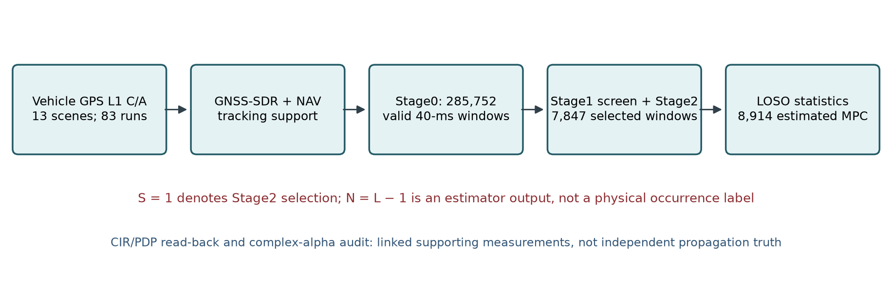

# Scene-Held-Out Statistical Characterization of SAGE-Estimated GPS L1 C/A Multipath in Dynamic Road Environments

**Complete English manuscript V0 — 30 October 2026.** This is a scientific draft, not a submission-ready typeset paper. All numerical claims concern the frozen Mainline Stage2 cohort unless a different subset is stated. Figure/table provenance and the bounded literature audit accompany this draft in [figure_audit.json](figures_final/figure_audit.json), [make_figures.py](make_figures.py), and [LITERATURE_AUDIT.md](LITERATURE_AUDIT.md). Gate G remains **PENDING**.

## Abstract

We characterize NAV-aided SAGE estimates of GPS L1 C/A multipath from vehicle recordings and ask which statistical descriptions transfer to unseen measurement scenes. The frozen cohort contains 83 processing runs in 13 scenes, 285,752 valid Stage0 windows, 7,847 Stage2-selected 40-ms windows, and 8,914 estimated multipath components (MPCs). We preserve selected windows with no estimated MPC and evaluate the conditional count and path-mark distributions by holding out complete scenes. A lognormal excess-delay candidate ranks first in all 13 folds of the original marginal comparison and is selected in all 13 outer training folds of a later fixed-bin analysis. Signed Doppler and relative-power family choices are less stable. The empirical selected-window count baseline has higher scene-macro log score than truncated Poisson and a boundary-fitting negative-binomial candidate. Neither a simple power–delay regression nor environment-specific parameterization produces a consistent scene-out improvement. For dependence evaluation, we score 0.01-chip delay cells, prespecified 5-Hz Doppler bins (10/20 Hz sensitivity), and continuous relative power on identical held-out windows. Gaussian-copula minus independent-marginal macro scores are −0.00768, −0.00864, and −0.00821 nats/mark, respectively, despite positive differences in 10 of 13 scenes at each width. CIR/PDP and complex-coefficient audits establish linkage and internal numerical consistency, not independent propagation truth. The results support a bounded, estimator- and selection-conditional statistical baseline; they do not establish an exact adaptive-estimator likelihood, a complete ordered-path generator, or a coherent time-varying physical channel model.

**Keywords:** GNSS multipath; GPS L1 C/A; SAGE; statistical channel characterization; scene-held-out validation; selection bias; quantized observations.

## I. Introduction

GNSS multipath depends jointly on propagation, receiver processing, and the geometry and motion of a recording. A distribution fitted to recovered echoes can be useful for a specified estimator and recording cohort, but it need not describe all physical rays or predict a new environment. This distinction becomes important when a high-resolution estimator first screens windows and then selects a model order: the resulting path count, delays, and powers are conditional outputs of that decision process.

Navigation multipath measurements and parametric channel models have a substantial history [R3], [R4]. SAGE is an established parameter-estimation method [R1], [R2], and real-GNSS urban multipath distributions have already been studied [R5]. Our question is therefore not whether SAGE or real-GNSS statistics can be invented anew. Rather, for one traceable, road-recorded GPS L1 C/A cohort, **which estimator-output statistics survive complete-scene holdout, and when does a more elaborate conditional or dependence model actually improve prediction?** This question requires keeping selection, scene structure, observation quantization, and failure cases visible.

We make three bounded contributions. First, we specify a complete Stage2-selected count-and-mark population, including zero-MPC selected windows and exact run/window/path linkage. Second, we compare marginal, environment/elevation-conditioned, and power–delay candidates under scene-held-out evaluation rather than treating pooled fit as generalization. Third, we make the dependence comparison on a clearly defined *fixed-binned output target*: delay cell probability, Doppler bin probability, and continuous-power density, paired within each held-out scene. The latter is a predictive evaluation of coarsened SAGE outputs—not an inverse recovery of the adaptive search trajectory. Negative and mixed findings are retained alongside favorable ones.

*Fig. 1 (F1).* Measurement-to-estimate workflow and population boundary. Stage2 selection is denoted by \(S=1\). CIR/PDP and complex alpha share measurement support and provide an audited linked representation, not independent physical truth. Counts are for this frozen cohort.

## II. Related Work and Positioning

The SAGE algorithm alternates parameter updates over chosen hidden-data spaces [R1]; its use for channel delay, Doppler, and complex-amplitude estimation was established for mobile-radio soundings [R2]. Our NAV-aided GPS L1 C/A implementation adopts that family of ideas, not a new expectation-maximization method. Its 40-ms windows, screening, BIC-based order choice, local search and normalization define the *observable* analyzed here.

Steingass and Lehner measured a navigation multipath channel across environments using a dedicated high-bandwidth sounding configuration [R3]. Pérez-Fontán and colleagues developed a measurement-parameterized land-mobile satellite generator with temporal, delay and Doppler behavior [R4]. These studies establish that environment-aware navigation/satellite-channel measurement and generation are prior art. They do not imply that their transmitter bandwidth, propagation observables or fitted parameters transfer to our live GPS estimator outputs. Wang, Chen and Liu derived multipath statistics from real GNSS signals in a static urban canyon and reported delay, attenuation and elevation-related analyses [R5]. This especially precludes a claim that real-GNSS multipath distribution fitting is new. Our comparison emphasizes dynamic road recordings, a fixed selection-conditional denominator, and whole-scene held-out evidence. Receiver Doppler *measurement error*, studied by Fang and colleagues [R7], is also distinct from our signed path-relative SAGE Doppler mark.

Finally, grouped cross-validation for structured observations is an established principle [R6]. The contribution here is its application at the scene level in a cohort where PRNs, runs, and overlapping windows within a scene cannot be regarded as independent experiments. The 13 leave-one-scene-out (LOSO) training sets overlap heavily; fold dispersion is descriptive sensitivity, not a confidence interval from 13 independent trials. The focused primary-source audit and its remaining bibliographic checks are documented in [LITERATURE_AUDIT.md](LITERATURE_AUDIT.md).

## III. Measurement, Estimator, and Frozen Dataset

### A. Recording and processing population

The data are vehicle-recorded GPS L1 C/A signals processed with GNSS-SDR tracking/navigation support and a NAV-aided SAGE pipeline. A *run* denotes a processing identity associated with a scene and tracking channel/PRN; 83 runs belong to 13 recording scenes. These are not 83 independent environmental replicates. Stage0 constructs NAV-supported valid 40-ms windows; Stage1 screens correlation candidates; Stage2 fits selected windows with candidate path order \(L=1,\ldots,4\). The Stage2 MPC count is \(N=L-1\), with one direct-*reference* estimate retained per selected window. “Direct reference” describes the estimator role; it is not a confirmed physical line-of-sight ray.

At the estimator level, the NAV-wiped window observation is represented by a sum of candidate code/Doppler replicas and noise, \(\mathbf y_i\approx\sum_{\ell=0}^{L-1}\alpha_{i\ell}\mathbf a_i(\tau_{i\ell},\nu_{i\ell})+\boldsymbol\epsilon_i\). For a specified set of delay/Doppler candidates the complex coefficients are least-squares estimates, while iterative local path searches and the frozen order/screening rules determine the retained set. This is an *estimation model*, not a claim that the measured channel comprises exactly the selected physical rays.

Of 285,752 valid Stage0 windows, 7,847 (2.7461%) enter Stage2. They contain 3,574/1,412/1,081/1,780 windows with \(N=0/1/2/3\), respectively; hence there are 8,914 MPC estimates and 7,847 reference-path records (16,761 Stage2 path records total). An unselected Stage0 window is **not** recoded as zero MPC, and \(N=0\) in a selected window is not evidence of no physical multipath. Table I lists the actual scene support. The labels S01–S13 are display identifiers; the exact recording identities are retained in [T1_scene_population.csv](figures_final/T1_scene_population.csv).

**Table I (T1). Frozen cohort by recording scene.** \(W_0\): valid Stage0 windows; \(W_2\): Stage2-selected windows; MPC: additional SAGE path estimates. CIR-linked counts equal \(W_2\) in every row; the complete mapping and GSV support are in the machine-readable table. The scene, not the row/MPC, is the outer validation unit.

| Scene | Environment | Runs | \(W_0\) | \(W_2\) | MPC |
|:--|:--|--:|--:|--:|--:|
| S01 | Highway/Open | 13 | 177,588 | 841 | 104 |
| S02 | Mountain/Valley | 7 | 7,092 | 592 | 837 |
| S03 | Mountain/Valley | 7 | 6,250 | 761 | 1,093 |
| S04 | Urban | 3 | 6,327 | 330 | 334 |
| S05 | Urban | 5 | 4,242 | 483 | 671 |
| S06 | Urban | 4 | 8,916 | 439 | 707 |
| S07 | Urban | 4 | 3,540 | 447 | 442 |
| S08 | Special Reflective | 9 | 19,909 | 987 | 1,172 |
| S09 | Urban | 8 | 12,281 | 842 | 1,429 |
| S10 | Special Reflective | 7 | 18,167 | 669 | 832 |
| S11 | Highway/Open | 5 | 5,214 | 449 | 471 |
| S12 | Urban | 5 | 9,090 | 386 | 115 |
| S13 | Mountain/Valley | 6 | 7,136 | 621 | 707 |
| **Total** | **13 scenes** | **83** | **285,752** | **7,847** | **8,914** |

*Fig. 2 (F2).* Estimated MPC count within the 7,847 **Stage2-selected** windows. It is a selection-conditional count, not a physical occurrence rate over all Stage0 windows.

### B. Path marks and measurement constraints

Let the fitted direct reference in window \(i\) have delay \(\hat\tau_{i0}\), Doppler \(\hat\nu_{i0}\), and complex coefficient \(\hat\alpha_{i0}\). For estimated extra path \(\ell\), the recorded marks are

\[
D_{i\ell}=\frac{\hat\tau_{i\ell}-\hat\tau_{i0}}{10}\;\mathrm{chips},\qquad
V_{i\ell}=\hat\nu_{i\ell}-\hat\nu_{i0}\;\mathrm{Hz},\qquad
P_{i\ell}=10\log_{10}\frac{|\hat\alpha_{i\ell}|^2}{|\hat\alpha_{i0}|^2}\;\mathrm{dB}.
\]

The delay coordinate uses 10 samples/chip. Local delay search advances by 0.1 sample (0.01 chip), while a one-sample separation rule and order selection constrain the recovered paths; the smallest recorded excess delay is 0.10 chip. Local Doppler search nominally advances by 5 Hz, but its start, bounds, iterations, and appended upper endpoint can vary. In 108 of 2,861 multi-MPC windows, a common translated 5-Hz lattice does not explain all final marks. Per-iteration candidates were not saved, so the exact adaptive Doppler observation cell cannot be reconstructed from the final value. The complex coefficients are fitted by least squares after per-window mean removal and RMS normalization of the 40-ms IQ; their phase is a within-window principal value in radians, not an established across-window coherent phase reference or an absolute calibrated channel gain.

*Fig. 3 (F3).* Excess delay (chips), signed relative Doppler (Hz), and relative power (dB) on the 8,914 estimated MPCs. Scene/window-balanced empirical masses are compared with **descriptive** full-population candidate refits integrated over the plotted bins. These curves are not held-out scores; the plotted 5-Hz Doppler bins are a fixed coarse observation target, not reconstructed adaptive search cells.

## IV. Statistical Methods

### A. Selection-conditional counts and path marks

The count target is \(p_n=\Pr(N=n\mid S=1)\), \(n\in\{0,1,2,3\}\), where \(S=1\) indicates Stage2 selection. For a training-scene set \(\mathcal T\), the empirical candidate is \(\hat p_n^{(\mathcal T)}=|\mathcal T|^{-1}\sum_{s\in\mathcal T}W_{s,n}/W_s\), where \(W_s\) and \(W_{s,n}\) count selected windows in scene \(s\). This gives scenes equal influence. Truncated Poisson and NB2 alternatives share the same finite support and held-out selected windows. An NB2 fit at infinite-mean boundary is recorded as a boundary solution, not as a stable interior maximum-likelihood estimate.

For mark distributions, the initial candidates were lognormal, gamma and Weibull for positive excess delay; normal, Student-t and Laplace for signed Doppler and relative power. The principal compact working marginals use a lognormal delay, Student-t Doppler and normal power. A full-population, scene/window-balanced *descriptive* refit gives delay lognormal shape \(\sigma_D=0.510756\), scale \(e^{\mu_D}=0.192930\) chips (location fixed at zero); signed-Doppler Student-t \(\nu=8.17295\), location 0.759586 Hz, scale 61.77635 Hz; and power normal mean −8.15758 dB, standard deviation 6.82687 dB. These parameters describe estimator-selected outputs and are **not** used as held-out predictions for their own training scenes. Parameter uncertainty is not obtained by treating 8,914 correlated paths as independent observations.

When fitting to MPC-bearing windows, a path in scene \(s\), window \(i\) is weighted proportionally to \(1/(W_s^{+}N_i)\), where \(W_s^{+}\) is that scene's number of selected windows with \(N_i>0\). Thus paths share a window's weight and scenes receive equal total weight. This is a composite/pseudo-likelihood weighting convention, not a claim of independent physical scatterers. The count model instead uses every selected window, including \(N_i=0\).

### B. Whole-scene held-out comparison

For each of 13 outer folds, all runs, PRNs, windows, and paths from one scene are withheld. Families and parameters for that fold are chosen or fitted only on the other scenes; nested selection is used where the fixed-bin dependence comparison requires it. For a mark density or mass model \(q_{-s}\), the held-out scene score averages within MPC-bearing windows \(I_s^+\) before averaging windows: \(L_s(q)=|I_s^+|^{-1}\sum_{i\in I_s^+}N_i^{-1}\sum_{\ell=1}^{N_i}\log q_{-s}(D_{i\ell},V_{i\ell},P_{i\ell})\). The 13-scene macro score is \(13^{-1}\sum_s L_s\). Count scores instead average \(\log p_{-s}(N_i)\) over *all* selected windows in the held-out scene. Model differences are paired only where test identity, observation support, and score measure match. This differs from a pooled-MPC score, which would overweight scenes and windows with more detected paths.

The original V0 continuous-density comparison remains useful for family screening but is not a valid final ranking for the adaptive Doppler output. Likewise, the 13 outer folds are overlapping training resamples, not independent replications. Unsupported tails, fit failures and missing geometry remain visible rather than being dropped to manufacture a favorable macro result.

### C. Conditional and dependence candidates

The WP3 global model is M0. M1 fits separate environment parameters only in the nine Urban (six) and Mountain/Valley (three) scenes with the specified support. M2 adds a continuous *measured GSV* elevation term within that supported subset. M0, M1 and M2 must be compared on identical test identities; M2 is not evaluated as if GSV were observed in every scene/window. The environmental and elevation fits are exploratory predictors, not causal estimates of building or satellite-geometry effects. Vehicle-motion conditioning was not fitted in this study.

The count-independent marked-path generator \(p(N\mid S=1)\prod_{\ell=1}^{N}q(D_\ell,V_\ell,P_\ell)\) is a *working baseline*, not an accepted complete ordered-path law. It assumes marks do not depend on \(N\) and that paths are conditionally exchangeable. Count-conditioned diagnostics found incomplete fit support for \(N=1\), limited \(N=3\) support in some scenes, and differences by delay-defined path rank. These limitations must not be concealed by a good marginal score.

To compare within-mark dependence on a validly declared target, let \(A_D(d)=[d-0.005,d+0.005)\) chips, subject to the fitted delay support, and \(A_V(k;w)=[(k-\tfrac12)w,(k+\tfrac12)w)\) Hz, with centers \(kw\) and zero fixed as the origin. Width \(w=5\) Hz is primary; 10 and 20 Hz are sensitivity analyses. The independent model assigns \(q_D(A_D)q_V(A_V)f_P(p)\). A Gaussian-copula candidate instead assigns the **joint two-cell probability conditional on the continuous power quantile**, multiplied by \(f_P(p)\):

\[
q_C(A_D,A_V,p)=f_P(p)\!\int_{z_D^-}^{z_D^+}\!\int_{z_V^-}^{z_V^+}
\frac{\varphi_3(z_D,z_V,z_P;R)}{\varphi(z_P)}\,dz_V\,dz_D,
\quad z_P=\Phi^{-1}(F_P(p)).
\]

Here the latent interval endpoints are marginal-CDF transforms of the fixed cells, \(R\) is fitted in training scenes, and \(\varphi_3/\varphi\) is the conditional Gaussian density. This is a mixed discrete–continuous score (nats/mark), not the continuous density of the original adaptive SAGE Doppler estimator. Marginal families and copula parameters are selected within the training fold; independent and copula predictions are paired at the **same bin width and same held-out windows**. Absolute scores across different bin widths should not be compared as if they used the same observation measure.

## V. Experimental Setup and Audit Trail

The analysis uses already frozen lightweight ledgers; no SAGE, CIR, or alpha production was rerun for this manuscript. Population and count evidence are from the audited V0 tables; WP2 supplies fold sensitivity, tail and power–delay comparisons; WP3 supplies paired M0/M1/M2 comparisons; WP4/5 supply read-back/linkage and alpha audits; the fixed-bin Gate G supplement supplies paired 13-scene dependence scores. The exact source paths and SHA-256 values used to render F1–F4/F7 and T1 are preserved in [figure_audit.json](figures_final/figure_audit.json). Figures were generated by [make_figures.py](make_figures.py) from those tables, with targeted checks in [test_make_figures.py](test_make_figures.py). This rendering does not refit the statistical models.

The primary inferential unit for generalization is the **recording scene**; overlapping 40-ms windows, PRNs in the same scene, and multiple paths in one selected window are dependent observations. Scene-macro summaries describe transfer among these 13 scenes. No path-row iid standard error or external-population confidence claim is made. Stage2 selection and the delay/Doppler search rules restrict the estimated-mark support. Geometry source and missingness are not assumed exchangeable with observed GSV values. The 13-scene global results and nine-scene environment subset are reported separately.

## VI. Results and Discussion

### A. Selected-window counts and marginal families

Figure 2 and Table I establish the denominator. The empirical categorical selected-window count model attains a 13-scene LOSO macro score of −1.297385 nats/selected window. On the same target, truncated Poisson is lower by 0.171584 nats/selected window; truncated NB2 is lower by 0.018255 nats/selected window and reaches an infinite-mean boundary in all 13 folds. Therefore a simple empirical count baseline is supported for this frozen *selected-window* population; no unselected-window zero class or unconditional multipath-occurrence law follows.

The original V0 marginal comparison ranks a lognormal delay candidate first in all 13 held-out scenes among its three candidate families; a later training-only fixed-bin analysis selects lognormal delay in all 13 outer training folds. These are related analyses of the **same data**, not two independent replication cohorts. Lognormal is a useful compact description of the recovered delay marks, but 0.01-chip search quantization, 0.10-chip minimum observed delay, order selection and tail support prevent a universal physical law claim. Doppler and relative-power candidate rankings are more variable, so their full-cohort descriptive parameters are not elevated to unique distributional truths. In WP2, 324 of 1,026 tail-diagnostic entries carry low-support flags; a pooled curve cannot erase those scene-specific limitations.

### B. Relationship and condition models

The pooled power–delay Spearman coefficient is −0.616410, and all 13 LOSO-fitted linear slopes are negative. However, the pooled linear \(R^2\) is only 0.055343. Against a marginal-power baseline on held-out scenes, the conditional regression's macro log-score difference is −0.0605013 nats/mark, and its RMSE difference is +0.182619 dB (positive means worse). The association is descriptive and not evidence that a linear relationship improves scene-out prediction or that delay causally determines attenuation.

For the nine supported Urban/Mountain scenes, M1 environment-specific versions do not show a consistent advantage over global M0; the M1−M0 macro differences of the reported candidate comparisons are negative. The six Urban scenes provide more support than the three Mountain/Valley scenes, while Highway/Open and Special Reflective each have only two scenes and are not silently folded into the same condition-specific comparison. On GSV-observed matched data, elevation model M2 sometimes improves over M1, but its comparison against M0 is mixed. Different geometry sources and missingness restrict any broader elevation conclusion. Thus the paper retains a global statistical baseline and treats environment/elevation terms as exploratory diagnostics, not two validated environment parameter sets or a general elevation law.

*Fig. 4 (F4).* Top: WP2 power–delay conditional minus marginal held-out log-score in 13 scenes (nats/mark). Bottom: WP3 environment M1 minus global M0 for the lognormal delay candidate in the **nine** supported core scenes, with identical test identities per comparison. Distinct panels have different model scopes; do not compare their absolute scores or infer a causal effect. Negative values favor the simpler baseline.

### C. Supporting CIR/PDP and complex-coefficient evidence

Gate E/F read-back covers 83 run identities and links all 7,847 selected windows and 8,914 MPC records. The code-domain CIR has 40 complex 1-ms correlation snapshots and 451 delay bins per Stage0 window; the stored PDP follows \(\mathrm{PDP}_{ik}=40^{-1}\sum_{m=1}^{40}|\mathrm{CIR}_{imk}|^2\). The independent read-back of that *computed* relation found zero maximum numerical difference in its validated scope, while 63 boundary-peak cases remain flagged. WP5 verifies all 16,761 retained complex coefficients and their path identities. These are valuable internal-consistency and linkage checks, yet CIR and SAGE share input recording and tracking support. A code-delay correlation width is not automatically a physical multipath delay spread, and the alpha phase is not validated for coherent evolution across windows. These audits strengthen provenance of the statistical target without supplying independent propagation truth.

### D. Fixed-bin dependence evaluation

Table II and Fig. 7 summarize the paired outer-scene dependence experiment. At each fixed width, the Gaussian-copula candidate improves the mean score in 10 scenes, but losses in three scenes are larger; the equal-scene macro difference is negative. The same 4,273 MPC-bearing selected windows are paired, with no unpaired windows, at each width. The mean is not a significance test, and the three widths are sensitivity views of the same cohort rather than separate replications. The observation target is deliberately coarsened Doppler, not the unavailable exact adaptive SAGE output likelihood. The result does **not** show that marks are independent; it shows that this particular fitted dependence candidate has no reliable scene-macro predictive gain over the independent marginals on the declared fixed-bin target.

**Table II (T2). Core whole-scene predictive comparisons.** Differences are candidate minus simpler baseline on matched support; negative values disfavor the candidate. Fold families/parameters are fitted only on training scenes. Count scores use selected windows; mark scores use held-out MPC-bearing selected windows. The 13 LOSO training sets overlap and are not independent trials.

| Target and comparison | Held-out scenes / support | Scene-macro difference | Interpretation |
|:--|:--|--:|:--|
| Selected count: truncated Poisson − empirical categorical | 13 / 7,847 selected windows | −0.171584 nats/window | Empirical baseline better; conditional on selection. |
| Selected count: truncated NB2 − empirical categorical | 13 / 7,847 selected windows | −0.018255 nats/window | NB2 at infinite-mean boundary in 13/13 folds. |
| Relative power: delay-conditional regression − marginal | 13 / matched MPC-bearing windows | −0.060501 nats/mark | Negative slope does not transfer as a predictive gain. |
| Environment M1 − global M0, delay lognormal | 9 Urban/Mountain scenes / paired core support | −0.024218 nats/mark | Environment split not promoted to final baseline. |
| Fixed-bin Copula − independent, 5 Hz | 13 / 4,273 paired MPC-bearing windows | −0.007684 nats/mark | 10 positive / 3 negative scenes; primary resolution. |
| Fixed-bin Copula − independent, 10 Hz | 13 / same 4,273 paired windows | −0.008640 nats/mark | Prespecified sensitivity resolution. |
| Fixed-bin Copula − independent, 20 Hz | 13 / same 4,273 paired windows | −0.008206 nats/mark | Prespecified sensitivity resolution. |

*Fig. 7 (F7).* Held-out scene differences for the declared fixed Doppler-bin target (5 Hz primary; 10/20 Hz sensitivity). Delay is scored as 0.01-chip cell probability and power as continuous density. All paired comparisons within a width use identical windows. The three adverse scenes dominate the macro mean despite 10 positive scenes at each width; this is not a test of physical independence.

## VII. Limitations and Submission Boundary

This is an **estimator-output, selection-conditional** study. Stage1 screening and Stage2 order selection, delay separation, Doppler adaptive grids, and SAGE path ordering shape its population. It neither estimates unselected-window multipath absence nor resolves individual physical reflectors. The 13 scenes are a limited set of recordings; environment classes have unequal support, overlapping windows and same-scene PRNs induce dependence, and LOSO fold training sets overlap. Accordingly the paper does not report MPC-row independent confidence intervals or universal environment laws. Low-support tails and numerical/boundary fits remain part of the evidence.

The fixed-bin likelihood is well-defined for a *coarsened final mark*, but the original adaptive Doppler candidate path was not saved. No exact search-cell probability or continuous-output likelihood is claimed. Count-conditioned mark fits are incomplete at \(N=1\), \(N=3\) has thin support in some scenes, and within-window paths ordered by delay are not established as exchangeable. A Gaussian copula's lack of stable macro benefit is not proof of physical independence. GSV source/missingness constrains elevation inference; motion conditions were not validated as model inputs. The CIR/PDP and SAGE alpha chain shares observations and is normalized per window; it is not an external propagation ground truth, absolute amplitude calibration, coherent inter-window phase series or validated time-varying physical generator. Thus WP4 Gate E/F may pass with limitations while the complete joint-generator Gate G remains pending.

Before journal submission, the author must review full texts of close comparators not available in this focused audit (notably Xie–Petovello), verify publisher bibliography metadata and figure reproduction permissions, choose venue length/style, and complete a line-by-line claim-to-source check. These are manuscript-completeness tasks, not reasons to restart frozen scientific production.

## VIII. Conclusion

Across the frozen 13-scene GPS L1 C/A cohort, a traceable Stage2-selected denominator and complete-scene validation support a compact empirical count and marginal-mark characterization of SAGE estimates. Lognormal is a stable *candidate* for recovered excess delay under the stated comparisons. The negative power–delay, environment, and fixed-bin copula predictive contrasts caution against treating pooled associations or extra parameters as automatic scene-out gains. The paper's contribution is the bounded, auditable measurement-statistics result—including where attractive dependence structures fail to generalize—not a universal physical channel law. A complete ordered, count-conditioned, coherent complex multipath generator remains unvalidated; Gate G is **PENDING**.

## References

[R1] J. A. Fessler and A. O. Hero, “Space-alternating generalized expectation-maximization algorithm,” *IEEE Trans. Signal Process.*, vol. 42, no. 10, pp. 2664–2677, 1994. [DOI](https://doi.org/10.1109/78.324732).

[R2] B. H. Fleury, M. Tschudin, R. Heddergott, D. Dahlhaus, and K. I. Pedersen, “Channel parameter estimation in mobile radio environments using the SAGE algorithm,” *IEEE J. Sel. Areas Commun.*, vol. 17, no. 3, pp. 434–450, 1999. [DOI](https://doi.org/10.1109/49.753729).

[R3] A. Steingass and A. Lehner, “Measuring the Navigation Multipath Channel—A Statistical Analysis,” *Proc. ION GNSS*, pp. 1157–1164, 2004. [DLR record](https://elib.dlr.de/22773/).

[R4] F. Pérez-Fontán, M. Vázquez-Castro, C. E. Cabado, J. P. García, and E. Kubista, “Statistical modeling of the LMS channel,” *IEEE Trans. Veh. Technol.*, vol. 50, no. 6, pp. 1549–1567, 2001. [DOI](https://doi.org/10.1109/25.966585).

[R5] Y. Wang, X. Chen, and P. Liu, “Statistical Multipath Model Based on Experimental GNSS Data in Static Urban Canyon Environment,” *Sensors*, vol. 18, no. 4, art. 1149, 2018. [DOI](https://doi.org/10.3390/s18041149).

[R6] D. R. Roberts *et al.*, “Cross-validation strategies for data with temporal, spatial, hierarchical, or phylogenetic structure,” *Ecography*, vol. 40, no. 8, pp. 913–929, 2017. [DOI](https://doi.org/10.1111/ecog.02881).

[R7] J. Fang, L. Zhang, G. Zhang, B. Xu, and L.-T. Hsu, “Characterization and Validation of GNSS Multipath-Induced Doppler Measurement Error,” *IEEE Trans. Aerosp. Electron. Syst.*, vol. 61, no. 2, pp. 3498–3515, 2025. [DOI](https://doi.org/10.1109/TAES.2024.3487132).
